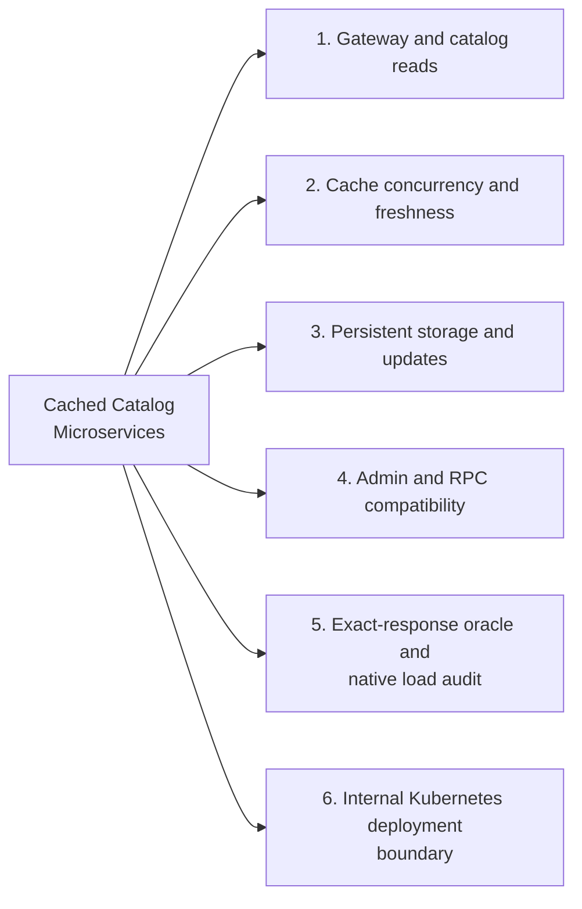
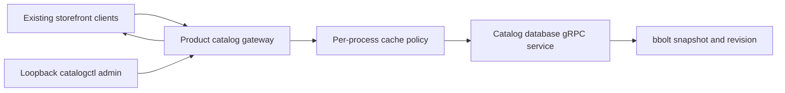
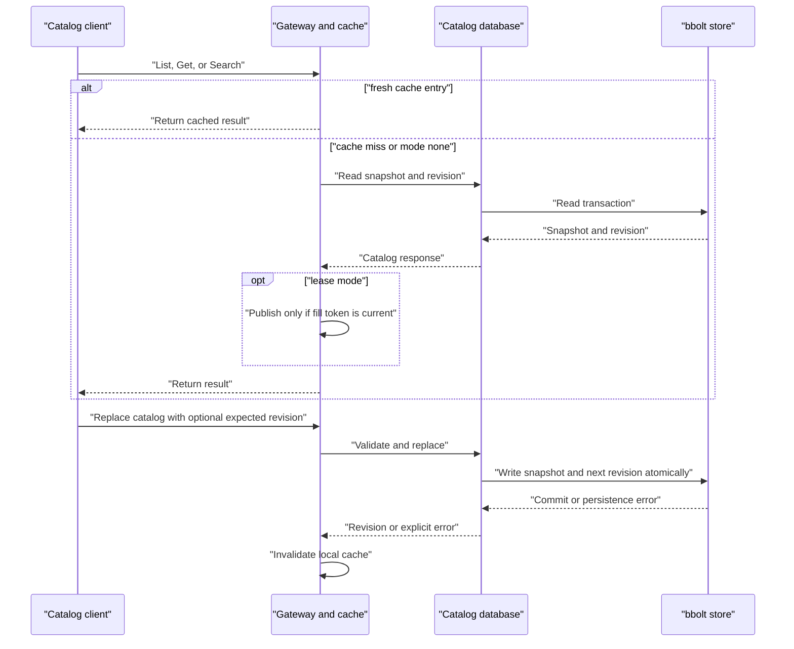

# Cached Catalog Microservices

## Contents

- [Architecture and execution guide](#architecture-and-execution-guide)
- [Implementation techniques](#implementation-techniques)
- [Local service configuration](#local-service-configuration)
- [Kubernetes](#kubernetes)
- [Verification evidence](#verification-evidence)
- [Reproduce sustained catalog measurements](#reproduce-sustained-catalog-measurements)

## Architecture and execution guide

### Subsystem map

Select a subsystem in the diagram to open its techniques, tradeoffs, and code references. The numbered links provide the same navigation. This map groups components; the execution diagrams show their runtime flow.



1. [Gateway and catalog reads](#subsystem-gateway-and-catalog-reads)
2. [Cache concurrency and freshness](#subsystem-cache-concurrency-and-freshness)
3. [Persistent storage and updates](#subsystem-persistent-storage-and-updates)
4. [Admin and RPC compatibility](#subsystem-admin-and-rpc-compatibility)
5. [Exact-response oracle and native load audit](#subsystem-exact-response-oracle-and-native-load-audit)
6. [Internal Kubernetes deployment boundary](#subsystem-internal-kubernetes-deployment-boundary)

This repository retains the upstream Online Boutique storefront and adds an optional persistent product-catalog backend with `none`, `ttl`, and `lease` gateway cache modes. Other storefront services remain upstream scope. The default catalog path still reads `products.json`; the database and gateway path starts only when configured.

The diagram places the catalog extension among the existing service boundaries.

<details>
<summary>Expand flow diagram 1</summary>



</details>

Read RPCs reach the gateway, which reads the backend or serves a [catalog snapshot](#catalog-snapshot) according to the selected cache mode. The database returns the snapshot and [revision](#catalog-revision) together. An update validates the full catalog, optionally checks the [expected revision](#expected-revision), and atomically replaces both fields in bbolt. The initiating gateway invalidates its local cache. Other gateways may serve an older snapshot until a successful refresh, so TTL is a configured freshness interval rather than a strict writer-relative staleness guarantee. [Lease mode](#fill-lease) coalesces cold fills and fences stale fills against local invalidation.

<details>
<summary>Expand flow diagram 2</summary>



</details>

| Subsystem | Responsibility and owned invariant | Source |
| --- | --- | --- |
| Gateway RPC and startup | Preserve ProductCatalogService RPCs and select file-backed or configured backend mode | [`catalog_gateway.go`](src/productcatalogservice/catalog_gateway.go) |
| Cache policy | Own per-process snapshots, TTL expiry, lease fill coalescing, and generation invalidation | [`catalog_cache.go`](src/productcatalogservice/catalog_cache.go) |
| Database RPC service | Read snapshots and revisions; implement admin updates and backend-read counters | [`catalogdb_service.go`](src/productcatalogservice/catalogdb_service.go) |
| Persistent store | Validate products; atomically write snapshot plus revision in bbolt | [`catalog_store.go`](src/productcatalogservice/catalog_store.go) |
| Kubernetes overlay | Add internal database, persistent volume, and gateway configuration | [`kustomize/overlays/catalog-cache/`](kustomize/overlays/catalog-cache/) |

### Follow a catalog request

1. The gateway starts in the original file-backed mode unless `CATALOG_BACKEND_ADDR` is set.
2. A List, Get, or Search call checks the selected cache policy. `none` calls the backend; TTL serves an unexpired snapshot; lease mode coalesces concurrent fills.
3. On a miss, the database reads snapshot and revision from bbolt and returns both. Lease mode publishes a fill only if its local generation remains current; TTL mode does not use that generation fence.
4. An admin replacement validates product fields and limits. A mismatched expected revision returns an explicit conflict.
5. bbolt commits the new snapshot and incremented revision in one write transaction. The initiating gateway invalidates its local cache. Other replicas need a successful refresh after expiry; expiry alone does not ensure convergence, and a late TTL-mode read can republish older data.
6. Backend and persistence failures remain explicit errors rather than successful responses.

<a id="catalog-snapshot"></a>
<details><summary>What is a catalog snapshot?</summary>

A catalog snapshot is the complete product list returned by one backend read. The database returns its revision alongside the data so a caller can identify the version it received.
</details>

<a id="catalog-revision"></a>
<details><summary>What is a catalog revision?</summary>

A catalog revision is a positive integer incremented with each successful replacement. An update based on revision 1 is rejected if another writer has already advanced the stored revision.
</details>

<a id="ttl-cache"></a>
<details><summary>What is a TTL cache?</summary>

A TTL cache reuses a snapshot until its time-to-live expires. After a successful refresh, that interval controls reuse; it is not a strict writer-relative staleness guarantee when reads fail or an older read completes late.
</details>

<a id="fill-lease"></a>
<details><summary>What is a fill lease?</summary>

A fill lease lets concurrent cache misses share one in-flight backend read. The implementation uses a generation check so an old read cannot publish after local invalidation.
</details>

<a id="generation-fence"></a>
<details><summary>What is a generation fence?</summary>

A generation fence rejects the result of a read started before the cache generation changed. It prevents an older in-flight fill from overwriting newer local cache state after an update.
</details>

<a id="expected-revision"></a>
<details><summary>What is an expected-revision check?</summary>

An expected-revision check makes a replacement conditional on the version the caller read. A mismatch returns a conflict instead of overwriting another update.
</details>

<a id="bbolt-transaction"></a>
<details><summary>What is a bbolt transaction?</summary>

A bbolt transaction groups database changes into one commit. The store writes catalog bytes and the next revision together, so a failed update does not intentionally advance only one field.
</details>

### Design choices and limits

These rationales are inferred from current code unless the repository's tracked notes record otherwise.

| Choice | Current behavior and rationale | Alternative and cost to reconsider |
| --- | --- | --- |
| Preserve file-backed default | Existing deployments keep upstream behavior unless configured. | Making the database mandatory would break current startup expectations. |
| Keep existing catalog RPCs | Storefront callers continue using the same ProductCatalogService contract. | A new API would force client changes and broaden compatibility work. |
| Keep cache state per gateway | Avoids adding a distributed cache dependency. | Shared caching could reduce duplicate reads but adds a service and failure mode. |
| Pair revision with atomic snapshot write | Gives callers a conflict check and keeps stored version paired with contents. | Last-write-wins is simpler but hides concurrent updates. |
| Bound remote staleness by TTL | Local invalidation is immediate; other gateways refresh after expiry. | Global invalidation requires coordination and changes availability costs. |
| Keep admin listener on loopback | Limits unauthenticated writes to the local namespace. | Remote administration needs authentication and network restrictions. |

An Apache-2.0 extension of Google's Online Boutique that makes its existing product catalog durable and observable, then compares three real read paths: uncached, TTL, and bounded lease-based caching. The lease path coalesces concurrent cold fills and fences stale in-flight snapshots after local catalog writes.

The app remains the complete upstream 11-service, multi-language Online Boutique. The existing `ProductCatalogService` gRPC API and storefront are unchanged. A separate bbolt-backed catalog process serves that API through the original Go product-catalog service; writes are validated and revision-checked. Each gateway owns its cache. TTL controls reuse after successful refreshes but is not a strict writer-relative staleness bound; lease fencing protects against stale fills within one gateway. This is not a claim of global linearizability.

## Implementation techniques

This section covers active P24 catalog paths, including inherited read RPC behavior and directly used protobuf methods; the other ten retained upstream services are outside the extension scope. Rationale is inferred from the current implementation unless noted otherwise.

<details>
<summary>Full technique index</summary>

| Subsystem | Techniques and source |
| --- | --- |
| Gateway and catalog reads | [Configured backend mode selection](#technique-backend-mode-selection), [Snapshot backend reads](#technique-snapshot-read-sharing), [Catalog scan for Get and Search](#technique-catalog-read-scan)  -  [`catalog_gateway.go`](src/productcatalogservice/catalog_gateway.go), [`catalogdb_service.go`](src/productcatalogservice/catalogdb_service.go), [`product_catalog.go`](src/productcatalogservice/product_catalog.go) |
| Cache concurrency and freshness | [Immutable snapshots with defensive copy-out](#technique-immutable-snapshot-copy-out), [Time-to-live snapshot reuse](#technique-ttl-cache-refresh), [Lease-based cold-miss coalescing](#technique-lease-cold-miss-coalescing), [Generation-fenced fill publication](#technique-generation-fenced-fill), [Canceled owner recovery](#technique-owner-cancellation-recovery)  -  [`catalog_cache.go`](src/productcatalogservice/catalog_cache.go), [`catalog_admin_http.go`](src/productcatalogservice/catalog_admin_http.go) |
| Persistent storage and updates | [Atomic snapshot and revision transaction](#technique-atomic-snapshot-revision), [Expected-revision compare and swap](#technique-optimistic-revision-cas), [First-start seeding and restart recovery](#technique-startup-seeding-and-recovery), [Catalog boundary validation](#technique-boundary-validation)  -  [`catalog_store.go`](src/productcatalogservice/catalog_store.go) |
| Admin and RPC compatibility | [Loopback HTTP admin adapter](#technique-loopback-admin-adapter), [Existing gRPC contract preservation](#technique-grpc-contract-preservation)  -  [`catalog_admin_http.go`](src/productcatalogservice/catalog_admin_http.go), [`catalog_gateway.go`](src/productcatalogservice/catalog_gateway.go), [`product_catalog.go`](src/productcatalogservice/product_catalog.go), [`catalog_admin.proto`](protos/catalog_admin.proto) |
| Exact-response oracle and native load audit | [Exact protobuf semantic response oracle](#technique-protobuf-semantic-response-oracle), [Scheduled native gRPC load accounting](#technique-native-scheduled-load-accounting)  -  [`load.go`](src/productcatalogservice/cmd/catalogctl/load.go), [`main.go`](src/productcatalogservice/cmd/catalogctl/main.go), [`catalog-k6.js`](scripts/catalog-k6.js), [`catalog-benchmark.py`](scripts/catalog-benchmark.py) |
| Internal Kubernetes deployment boundary | [Internal services with persistent volume](#technique-internal-service-and-persistent-volume-overlay)  -  [`kustomization.yaml`](kustomize/overlays/catalog-cache/kustomization.yaml) |

</details>

<a id="subsystem-gateway-and-catalog-reads"></a>

### 1. Gateway and catalog reads

[Back to the subsystem map](#architecture-and-execution-guide).

**Code.** [`src/productcatalogservice/catalog_gateway.go`](src/productcatalogservice/catalog_gateway.go), [`src/productcatalogservice/product_catalog.go`](src/productcatalogservice/product_catalog.go), [`src/productcatalogservice/catalogdb_service.go`](src/productcatalogservice/catalogdb_service.go).

**Techniques.** [Configured backend mode selection](#technique-backend-mode-selection), [Snapshot backend reads](#technique-snapshot-read-sharing), [Catalog scan for Get and Search](#technique-catalog-read-scan).

<a id="technique-backend-mode-selection"></a>
<details>
<summary>Configured backend mode selection</summary>

**Mechanism.** `newProductCatalogService` preserves file loading when `CATALOG_BACKEND_ADDR` is unset. With an address, it creates a gRPC client, bounds backend timeout and TTL, and selects `none`, `ttl`, or `lease`.

**Example.** `CATALOG_BACKEND_ADDR=127.0.0.1:3551 CATALOG_CACHE_MODE=lease` routes reads through the configured cache.

**Why here.** It adds an opt-in catalog backend while retaining the existing deployment default.

**Tradeoffs.** Configuration errors stop startup. The backend connection uses insecure transport credentials, so deployment network boundaries matter.

**Code and ownership.** [catalog_gateway.go](src/productcatalogservice/catalog_gateway.go#L32)  -  extension.


**Used in.** [Gateway and catalog reads](#subsystem-gateway-and-catalog-reads). [Back to the subsystem map](#architecture-and-execution-guide).

</details>

<a id="technique-snapshot-read-sharing"></a>
<details>
<summary>Snapshot backend reads</summary>

**Mechanism.** The database service reads one complete protobuf snapshot and its revision from the store, then returns the same full snapshot through List, Get, and Search RPC implementations. This avoids separate store reads per catalog method, while those methods still scan the returned products.

**Example.** `GetProduct` receives the snapshot then searches for its requested ID.

**Why here.** All three existing read methods share one durable representation and revision.

**Tradeoffs.** A full catalog travels over gRPC even for one product. Backend errors and canceled contexts remain RPC errors.

**Code and ownership.** [catalogdb_service.go](src/productcatalogservice/catalogdb_service.go#L38)  -  extension.


**Used in.** [Gateway and catalog reads](#subsystem-gateway-and-catalog-reads). [Back to the subsystem map](#architecture-and-execution-guide).

</details>

<a id="technique-catalog-read-scan"></a>
<details>
<summary>Catalog scan for Get and Search</summary>

**Mechanism.** Get walks products until its ID matches. Search lowercases each name and description and checks substring inclusion, collecting matching product pointers into the response.

**Example.** `strings.Contains(strings.ToLower(product.Name), strings.ToLower(req.Query))` checks a name.

**Why here.** This preserves the upstream ProductCatalogService behavior and needs no secondary index.

**Tradeoffs.** Each request scans the catalog; Get and Search do not use an ID map or text index.

**Code and ownership.** [product_catalog.go](src/productcatalogservice/product_catalog.go#L56)  -  inherited.


**Used in.** [Gateway and catalog reads](#subsystem-gateway-and-catalog-reads). [Back to the subsystem map](#architecture-and-execution-guide).

</details>

<a id="subsystem-cache-concurrency-and-freshness"></a>

### 2. Cache concurrency and freshness

[Back to the subsystem map](#architecture-and-execution-guide).

**Code.** [`src/productcatalogservice/catalog_cache.go`](src/productcatalogservice/catalog_cache.go), [`src/productcatalogservice/catalog_admin_http.go`](src/productcatalogservice/catalog_admin_http.go).

**Techniques.** [Immutable snapshots with defensive copy-out](#technique-immutable-snapshot-copy-out), [Time-to-live snapshot reuse](#technique-ttl-cache-refresh), [Lease-based cold-miss coalescing](#technique-lease-cold-miss-coalescing), [Generation-fenced fill publication](#technique-generation-fenced-fill), [Canceled owner recovery](#technique-owner-cancellation-recovery).

<a id="technique-immutable-snapshot-copy-out"></a>
<details>
<summary>Immutable snapshots with defensive copy-out</summary>

**Mechanism.** The cache treats a published protobuf snapshot as immutable. It captures the pointer while holding the mutex, releases the lock, then uses `proto.Clone` before returning data to callers. Fill publication similarly retains the fetched object without exposing it directly.

**Example.** `snapshot := c.snapshot; c.mu.Unlock(); return cloneCatalog(snapshot), nil` avoids copying the full catalog under the lock.

**Why here.** The mutex protects cache metadata while callers get independently mutable protobufs.

**Tradeoffs.** Cloning still costs work per response; immutability is a cache invariant and must hold for every internal writer.

**Code and ownership.** [catalog_cache.go](src/productcatalogservice/catalog_cache.go#L105)  -  extension; clone uses the protobuf dependency.


**Used in.** [Cache concurrency and freshness](#subsystem-cache-concurrency-and-freshness). [Back to the subsystem map](#architecture-and-execution-guide).

</details>

<a id="technique-ttl-cache-refresh"></a>
<details>
<summary>Time-to-live snapshot reuse</summary>

**Mechanism.** TTL mode serves the cached snapshot before `expires`; on a miss it fetches the backend and then replaces the cache with a new expiry. Concurrent misses are intentionally not coalesced. A successful local admin write invalidates this process's entry.

**Example.** A 2-second TTL allows reuse until `time.Now()` reaches `expires`.

**Why here.** It offers simple bounded local reuse for the configured cache interval.

**Tradeoffs.** TTL is not strict cross-replica freshness: failed refreshes surface errors, a late read can republish an older snapshot, and expiry alone cannot guarantee the next successful refresh. Another replica can remain stale until it refreshes.

**Code and ownership.** [catalog_cache.go](src/productcatalogservice/catalog_cache.go#L115), [catalog_admin_http.go](src/productcatalogservice/catalog_admin_http.go#L86)  -  extension.


**Used in.** [Cache concurrency and freshness](#subsystem-cache-concurrency-and-freshness). [Back to the subsystem map](#architecture-and-execution-guide).

</details>

<a id="technique-lease-cold-miss-coalescing"></a>
<details>
<summary>Lease-based cold-miss coalescing</summary>

**Mechanism.** Lease mode records one in-flight `cacheFlight`. Concurrent misses wait on its `done` channel or their own context; the owner fetches once, then publishes and closes the channel. Waiters retry if no valid cache entry was published.

**Example.** On a cold cache, later callers join `c.flight` instead of invoking `c.fetch` themselves.

**Why here.** It reduces duplicate concurrent cold reads within one gateway process.

**Tradeoffs.** Coordination is process-local, not distributed across gateway replicas. Waiters can cancel independently; owner cancellation has a separate recovery path.

**Code and ownership.** [catalog_cache.go](src/productcatalogservice/catalog_cache.go#L136)  -  extension. The design is informed by [Scaling Memcache at Facebook](https://www.usenix.org/system/files/conference/nsdi13/nsdi13-final170_update.pdf), a bounded adaptation.


**Used in.** [Cache concurrency and freshness](#subsystem-cache-concurrency-and-freshness). [Back to the subsystem map](#architecture-and-execution-guide).

</details>

<a id="technique-generation-fenced-fill"></a>
<details>
<summary>Generation-fenced fill publication</summary>

**Mechanism.** A fill records the cache generation when it becomes owner. `Invalidate` increments that generation. The fetched snapshot is published only if the captured token still equals the current generation; otherwise the fill is fenced and the lease loop retries.

**Example.** An update during a delayed backend read makes `flight.token == c.generation` false, preventing publication of that old result.

**Why here.** It prevents an in-flight lease fill from restoring a pre-invalidation snapshot in the same process.

**Tradeoffs.** This is a local fence only. TTL mode does not apply it, and it does not coordinate independent replicas.

**Code and ownership.** [catalog_cache.go](src/productcatalogservice/catalog_cache.go#L171)  -  extension.


**Used in.** [Cache concurrency and freshness](#subsystem-cache-concurrency-and-freshness). [Back to the subsystem map](#architecture-and-execution-guide).

</details>

<a id="technique-owner-cancellation-recovery"></a>
<details>
<summary>Canceled owner recovery</summary>

**Mechanism.** The owner stores its fetch error in the flight. If its context was canceled, it marks `ownerCanceled`; waiters observing that result loop and one can become the next owner. Other backend errors are returned to waiters.

**Example.** A caller timeout on the owner request does not force all waiters to inherit that cancellation error.

**Why here.** Each waiter may have a longer-lived context than the caller that began the shared fetch.

**Tradeoffs.** A non-cancellation backend failure is shared by waiters; retry is caller-driven, not an automatic blanket retry.

**Code and ownership.** [catalog_cache.go](src/productcatalogservice/catalog_cache.go#L146)  -  extension.


**Used in.** [Cache concurrency and freshness](#subsystem-cache-concurrency-and-freshness). [Back to the subsystem map](#architecture-and-execution-guide).

</details>

<a id="subsystem-persistent-storage-and-updates"></a>

### 3. Persistent storage and updates

[Back to the subsystem map](#architecture-and-execution-guide).

**Code.** [`src/productcatalogservice/catalog_store.go`](src/productcatalogservice/catalog_store.go), [`src/productcatalogservice/catalogdb_service.go`](src/productcatalogservice/catalogdb_service.go).

**Techniques.** [Atomic snapshot and revision transaction](#technique-atomic-snapshot-revision), [Expected-revision compare and swap](#technique-optimistic-revision-cas), [First-start seeding and restart recovery](#technique-startup-seeding-and-recovery), [Catalog boundary validation](#technique-boundary-validation).

<a id="technique-atomic-snapshot-revision"></a>
<details>
<summary>Atomic snapshot and revision transaction</summary>

**Mechanism.** `Replace` validates and marshals before opening a bbolt write transaction. Inside the transaction it writes snapshot bytes and the next revision; bbolt commits both together or returns an error. Reads retrieve both values in one read transaction.

**Example.** `bucket.Put(catalogKey, encoded)` is followed by `bucket.Put(revisionKey, encodeRevision(nextRevision))` in one `db.Update` callback.

**Why here.** A reader should not pair a newly written catalog with an old revision or vice versa.

**Tradeoffs.** Persistence errors abort the update. The backend is a single local bbolt database, not replicated consensus storage.

**Code and ownership.** [catalog_store.go](src/productcatalogservice/catalog_store.go#L98)  -  extension; bbolt supplies transaction machinery.


**Used in.** [Persistent storage and updates](#subsystem-persistent-storage-and-updates). [Back to the subsystem map](#architecture-and-execution-guide).

</details>

<a id="technique-optimistic-revision-cas"></a>
<details>
<summary>Expected-revision compare and swap</summary>

**Mechanism.** When provided, the expected revision is compared with the current revision inside the write transaction. A mismatch returns `errCatalogRevisionMismatch` and does not write either field. The service maps it to gRPC Aborted and the HTTP adapter maps that to conflict.

**Example.** Two writers both expecting revision 4 cannot both replace the catalog; the later transaction sees a mismatch.

**Why here.** It lets clients prevent overwriting a version they did not read.

**Tradeoffs.** Conflict aborts do not wait or retry; the client must read and decide whether to submit again. The check is optional.

**Code and ownership.** [catalog_store.go](src/productcatalogservice/catalog_store.go#L123), [catalogdb_service.go](src/productcatalogservice/catalogdb_service.go#L98)  -  extension.


**Used in.** [Persistent storage and updates](#subsystem-persistent-storage-and-updates). [Back to the subsystem map](#architecture-and-execution-guide).

</details>

<a id="technique-startup-seeding-and-recovery"></a>
<details>
<summary>First-start seeding and restart recovery</summary>

**Mechanism.** On a new database file, startup creates the bucket, loads and validates the seed JSON, writes the serialized snapshot, and starts at revision 1. Existing files must contain both snapshot and valid positive revision; startup reads persisted state instead of reseeding.

**Example.** Restarting with the same `CATALOG_DB_PATH` preserves successful admin updates.

**Why here.** The durable backend must survive process and pod restarts while retaining seed convenience for first creation.

**Tradeoffs.** A malformed or incomplete existing database fails startup rather than silently resetting user data. Changing the seed file does not replace an existing database.

**Code and ownership.** [catalog_store.go](src/productcatalogservice/catalog_store.go#L41)  -  extension.


**Used in.** [Persistent storage and updates](#subsystem-persistent-storage-and-updates). [Back to the subsystem map](#architecture-and-execution-guide).

</details>

<a id="technique-boundary-validation"></a>
<details>
<summary>Catalog boundary validation</summary>

**Mechanism.** `validateCatalog` checks total product count and protobuf size, required fields, field limits, duplicate IDs, USD price constraints, and category values before seeding or replacement. The HTTP parser also caps body size, rejects unknown fields and trailing JSON values, then decodes protobuf JSON.

**Example.** An 8 MiB limit is enforced on both HTTP input and protobuf catalog size.

**Why here.** Writes cross an admin boundary and become durable state consumed by all read RPCs.

**Tradeoffs.** Limits are fixed in code. Invalid input fails explicitly rather than being partially accepted.

**Code and ownership.** [catalog_store.go](src/productcatalogservice/catalog_store.go#L186), [catalog_admin_http.go](src/productcatalogservice/catalog_admin_http.go#L86)  -  extension.


**Used in.** [Persistent storage and updates](#subsystem-persistent-storage-and-updates). [Back to the subsystem map](#architecture-and-execution-guide).

</details>

<a id="subsystem-admin-and-rpc-compatibility"></a>

### 4. Admin and RPC compatibility

[Back to the subsystem map](#architecture-and-execution-guide).

**Code.** [`src/productcatalogservice/catalog_admin_http.go`](src/productcatalogservice/catalog_admin_http.go), [`src/productcatalogservice/catalog_gateway.go`](src/productcatalogservice/catalog_gateway.go), [`protos/catalog_admin.proto`](protos/catalog_admin.proto), [`src/productcatalogservice/genproto/demo.pb.go`](src/productcatalogservice/genproto/demo.pb.go).

**Techniques.** [Loopback HTTP admin adapter](#technique-loopback-admin-adapter), [Existing gRPC contract preservation](#technique-grpc-contract-preservation).

<a id="technique-loopback-admin-adapter"></a>
<details>
<summary>Loopback HTTP admin adapter</summary>

**Mechanism.** The gateway binds admin HTTP to `127.0.0.1`, translates revision, stats, metrics and update requests to the internal admin gRPC client, applies request timeouts, and maps gRPC status codes to HTTP statuses. A successful update invalidates the local cache.

**Example.** A revision conflict becomes HTTP 409; backend unavailable or deadline becomes 503.

**Why here.** Local tooling can administer the backend without changing existing storefront RPC consumers.

**Tradeoffs.** Loopback binding limits network reachability but is not authentication; the pod network namespace and internal-only service design remain part of the boundary.

**Code and ownership.** [catalog_gateway.go](src/productcatalogservice/catalog_gateway.go#L84), [catalog_admin_http.go](src/productcatalogservice/catalog_admin_http.go#L41)  -  extension.


**Used in.** [Admin and RPC compatibility](#subsystem-admin-and-rpc-compatibility). [Back to the subsystem map](#architecture-and-execution-guide).

</details>

<a id="technique-grpc-contract-preservation"></a>
<details>
<summary>Existing gRPC contract preservation</summary>

**Mechanism.** The gateway and database both implement the existing generated `ProductCatalogService` RPCs. The new internal `CatalogAdminService` is additive; its replacement request carries the catalog and an explicit boolean plus expected revision for conditional updates.

**Example.** Existing clients continue calling `ListProducts`, `GetProduct`, and `SearchProducts` using the unchanged demo protobuf definitions.

**Why here.** The catalog backend is an implementation change behind the storefront's established RPC boundary.

**Tradeoffs.** The admin protocol adds generated schema and requires version-compatible internal callers; public read methods keep their full-catalog behavior.

**Code and ownership.** [product_catalog.go](src/productcatalogservice/product_catalog.go#L45), [catalog_admin.proto](protos/catalog_admin.proto#L1)  -  mixed inherited read contract and extension admin API.


**Used in.** [Admin and RPC compatibility](#subsystem-admin-and-rpc-compatibility). [Back to the subsystem map](#architecture-and-execution-guide).

</details>

<a id="subsystem-exact-response-oracle-and-native-load-audit"></a>

### 5. Exact-response oracle and native load audit

[Back to the subsystem map](#architecture-and-execution-guide).

**Code.** [`src/productcatalogservice/cmd/catalogctl/main.go`](src/productcatalogservice/cmd/catalogctl/main.go), [`src/productcatalogservice/cmd/catalogctl/load.go`](src/productcatalogservice/cmd/catalogctl/load.go), [`src/productcatalogservice/genproto/demo.pb.go`](src/productcatalogservice/genproto/demo.pb.go), [`scripts/catalog-k6.js`](scripts/catalog-k6.js), [`scripts/catalog-benchmark.py`](scripts/catalog-benchmark.py).

**Techniques.** [Exact protobuf semantic response oracle](#technique-protobuf-semantic-response-oracle), [Scheduled native gRPC load accounting](#technique-native-scheduled-load-accounting).

<a id="technique-protobuf-semantic-response-oracle"></a>
<details>
<summary>Exact protobuf semantic response oracle</summary>

**Mechanism.** The catalogctl load driver loads an expected protobuf catalog and checks returned List, Get, and Search results against expected messages, including `proto.Equal` on generated protobuf messages; the Go driver does not compare serialized bytes. This tests response correctness, not generated natural-language content.

**Example.** A response with one changed product field fails the oracle even if its shape and status are valid.

**Why here.** Cache and persistence changes should preserve the existing catalog response contract across modes.

**Tradeoffs.** The oracle covers the fixture and request mix; it does not prove all possible catalogs or measure performance.

**Code and ownership.** [load.go](src/productcatalogservice/cmd/catalogctl/load.go#L33), [main.go](src/productcatalogservice/cmd/catalogctl/main.go#L111)  -  extension using generated protobuf types.


**Used in.** [Exact-response oracle and native load audit](#subsystem-exact-response-oracle-and-native-load-audit). [Back to the subsystem map](#architecture-and-execution-guide).

</details>

<a id="technique-native-scheduled-load-accounting"></a>
<details>
<summary>Scheduled native gRPC load accounting</summary>

**Mechanism.** The native k6 path schedules offered gRPC arrivals at configured rates, uses bounded virtual users, retains successes, failures and dropped iterations, and separates successful RPC durations from whole iteration timing. Exact oracle checks are reported independently of latency.

**Example.** A dropped scheduled offer has no inferred RPC latency because no request completed.

**Why here.** Native gRPC measurements retain scheduling pressure and errors alongside completed request timings.

**Tradeoffs.** Strict count discrepancies and incomplete duration samples remain audit limitations; the recorded campaigns are explicitly inconclusive for performance superiority and do not establish an SLO.

**Code and ownership.** [Native k6 arrivals and VU bounds](scripts/catalog-k6.js#L33), [native timing and drop policy](scripts/catalog-k6.js#L78), [raw receipt audit](scripts/catalog-benchmark.py#L120), and the [measurement guide](docs/k6-measurement.md), extension using k6's native executor.


**Used in.** [Exact-response oracle and native load audit](#subsystem-exact-response-oracle-and-native-load-audit). [Back to the subsystem map](#architecture-and-execution-guide).

</details>

<a id="subsystem-internal-kubernetes-deployment-boundary"></a>

### 6. Internal Kubernetes deployment boundary

[Back to the subsystem map](#architecture-and-execution-guide).

**Code.** [`kustomize/overlays/catalog-cache/kustomization.yaml`](kustomize/overlays/catalog-cache/kustomization.yaml).

**Techniques.** [Internal services with persistent volume](#technique-internal-service-and-persistent-volume-overlay).

<a id="technique-internal-service-and-persistent-volume-overlay"></a>
<details>
<summary>Internal services with persistent volume</summary>

**Mechanism.** The catalog-cache Kustomize overlay deploys the gateway and database as internal services and gives the database a persistent volume claim. Network policy/service selection limits database ingress to the catalog gateway path.

**Example.** Restarting the database pod reuses its bound claim rather than reseeding a fresh in-memory catalog.

**Why here.** The verification deployment exercises the actual durable backend without exposing an unauthenticated admin endpoint publicly.

**Tradeoffs.** Rendering manifests alone does not prove live Kubernetes behavior; this overlay is a verification topology, not a production availability claim.

**Code and ownership.** [catalog-cache overlay](kustomize/overlays/catalog-cache/kustomization.yaml#L1)  -  extension.


**Used in.** [Internal Kubernetes deployment boundary](#subsystem-internal-kubernetes-deployment-boundary). [Back to the subsystem map](#architecture-and-execution-guide).

</details>

## Verify locally

The maintained native Windows driver launches real database and gateway processes, exercises the gRPC/UI-facing API path, races, persistent updates, backend failure and restart, cache rebuild, and latency measurements, then retains logs and evidence while cleaning its own scratch processes and files:

```powershell
pwsh -NoProfile -File .agents/skills/verify-productcatalog/verify.ps1
```

It uses the project's isolated Go 1.27.3 toolchain on this Windows host, or Go 1.27.3 from `PATH` on Linux. To run the Go package checks directly from `src/productcatalogservice`:

```powershell
go test ./...
go vet ./...
```

## Local service configuration

The product catalog service preserves its upstream file-backed behavior when `CATALOG_BACKEND_ADDR` is unset. To use the durable backend, run the product-catalog server once in database mode and once as the gateway. Configure the backend address, cache mode (`none`, `ttl`, or `lease`), TTL, and optional loopback admin port with `CATALOG_BACKEND_ADDR`, `CATALOG_CACHE_MODE`, `CATALOG_CACHE_TTL`, and `CATALOG_ADMIN_PORT`. The database persists to `CATALOG_DB_PATH` and seeds from `CATALOG_SEED_PATH` only when that database is new. See [service configuration and admin endpoints](src/productcatalogservice/README.md).

The `src/productcatalogservice/cmd/catalogctl` client provides gRPC `list`, `get`, `search`, concurrent `bench`, and loopback-only admin `update`, `revision`, `stats`, and `metrics` commands. Admin HTTP is bound to loopback; the Kubernetes overlay exposes it only inside the product-catalog pod network namespace.

## Kubernetes

Render the internal-only persistent-catalog overlay with:

```powershell
.tools\bin\kustomize.exe build kustomize\overlays\catalog-cache
```

The overlay adds a one-replica database StatefulSet and persistent volume, restricts database ingress to product-catalog pods, and removes the storefront LoadBalancer. The manually triggered `catalog-cache-kind` workflow renders that overlay, applies only the catalog gateway and database resource set to its disposable kind cluster, then deletes the cluster in a hosted GitHub runner; it is not a production or cloud deployment.

## Upstream source and attribution

This repository is a full-history clone of [GoogleCloudPlatform/microservices-demo](https://github.com/GoogleCloudPlatform/microservices-demo) at `38e7348eb289eb5b87c0c6e8cb19ced0449dc389`. Its Apache license, notices, application source, manifests, and history are retained. The original upstream root README is preserved verbatim as [README.upstream.md](README.upstream.md); dangerous inherited deployment, release, and cleanup workflows are byte-identically archived under [archive/upstream-github-workflows](archive/upstream-github-workflows). The active workflows are read-only Go validation and an explicit manual disposable-cluster smoke test.

The lease design is informed by Nishtala et al., [Scaling Memcache at Facebook (NSDI 2013), §3.2.1](https://www.usenix.org/system/files/conference/nsdi13/nsdi13-final170_update.pdf). This implementation is a bounded catalog-specific adaptation, not a reproduction of Facebook's infrastructure.

## Verification evidence

The [Windows process result](docs/evidence/windows-process.json) and [Linux process result](docs/evidence/linux-process.json) record the real journeys and observed cache behavior. Linux tests, race detection, vet, formatting and process verification passed in [run 39718372237](https://github.com/STEVVVU/cached-catalog-microservices/actions/runs/39718372237).

The disposable Kubernetes journey passed in [run 39718372293](https://github.com/STEVVVU/cached-catalog-microservices/actions/runs/39718372293). Its [retained results](docs/evidence/kind-39718372293/) show 40/40 gRPC requests completed, a catalog update to revision 2, the same data after database and gateway pod restarts, a bound PVC, internal services, and cluster cleanup. Only the seven catalog resources were applied. The complete 11-service storefront was not deployed in this check. Small synthetic latency samples do not establish an SLO or a general performance advantage.

## Reproduce sustained catalog measurements

The latest [same-host native k6 comparison](docs/benchmarks/2026-10-22-matched-k6.md) completed all 1,086 trials: five repeats across 108 configuration/mode groups per build plus six restart/stability trials. The AMD EPYC runner exposed four logical CPUs shared by the generator, gateways and durable database. Both builds produced zero exact-response mismatches, but the comparison **did not establish a performance improvement or service capacity**.

A later focused native k6 campaign completed all 15 cells and is documented in [the 24 October audit](docs/benchmarks/2026-10-24-focused-k6.md). Its strict 2,000-request audit remains inconclusive: seven cells matched the planned count, while eight contain 2,001 successful requests after a terminal scheduled arrival. The corrected audit still reports 32 errors. This result does not confirm the Go-driver measurements below.

| Recorded outcomes | Baseline | Copy-outside-lock candidate |
| --- | ---: | ---: |
| Exact-checked successful operations | 2,657,306 | 2,661,921 |
| Failed operations | 3,207 | 2,926 |
| Dropped before start | 4,106,205 | 4,103,442 |
| Explicit RPC deadlines, included in failures | 163 | 156 |
| Missing native status-zero duration samples | 14 | 23 |

Main reconciled all 1,086 native summaries and exact Go oracle receipts against the complete compressed metric streams, including counts, gzip integrity and native p50/p95/p99. The [curated evidence](docs/evidence/matched-k6-20261022/summary.json) retains every group, trial, error, restart and receipt hash. In 35 large-catalog trials, 37 successful calls lacked native duration samples; affected percentiles describe the recorded subset. High-rate drops, shared resources and overlapping trial ranges prevent a general speedup or SLO claim. The original workload, limits and earlier failed campaigns are preserved. These accounting totals span different workloads and are not pooled performance statistics.

The [complete initial Go-driver baseline](docs/benchmarks/2026-10-22-go-baseline.md) reports all 36 workload configurations on a four-logical-CPU Intel Xeon 8370C Ubuntu runner with Go 1.27.3. For 500 products, one gateway and 1,000 offers/s, warm-cache scheduled-response p99 was 2.97 ms [2.78, 3.00] versus 9.96 ms [9.51, 10.62] without caching, with all offers completed in each of five trials. The report also retains the adverse 5,000-product/1 ms lease-expiry case and all errors: 56 deadlines, 2,345 intentional-restart Unavailable responses and 3,166,201 generator rejections across 6,768,000 offers. Successful responses had zero correctness mismatches; no general capacity or cache superiority claim follows. The full matrix, restart/stability outcomes, resources, commands and raw artifact link are retained separately from the native k6 campaign.

The [native k6 path](docs/k6-measurement.md) reuses the real service launcher, fixtures, restart controls and Go protobuf oracle. Its manual workflow defaults to a setup smoke before the full campaign. k6 supplies native gRPC timing, constant-arrival-rate scheduling, fixed VU caps, errors and dropped-iteration counts. Successful-RPC duration and whole started-iteration duration remain separate, and dropped offers receive no inferred latency. The initial Go campaign below remains reproducible with its original measurement definition.

From `src/productcatalogservice`, build `go build -trimpath -o ../../bin/productcatalogservice .` and `go build -trimpath -o ../../bin/catalogctl ./cmd/catalogctl`. From the repository root, run `python3 scripts/catalog-benchmark.py --output reports/evidence/benchmark`. The manual [catalog benchmark workflow](.github/workflows/catalog-benchmark.yml) retains the complete workload, raw samples and resource evidence. Its profile input runs separate eight-second CPU, mutex and blocking profiles in a binary built with the `benchmark` tag. With both `profile` and `profile_expiry` enabled, it diagnoses the original 5,000-product, one-gateway, 1ms-TTL, 1,000-offer/s cell in all three modes for ten seconds. [Profile run 39742164600](https://github.com/STEVVVU/cached-catalog-microservices/actions/runs/39742164600) passed all 30,000 outcome records and exact catalog checks, with cleanup. Lease mutex annotations attribute 77.21% of aggregate mutex wait to unlocking after a full-catalog clone; generator equality also consumed 49.18% of its sampled CPU. Those are diagnostic profiles, not response latency or service capacity. That runner did not reproduce the original timeouts. The candidate copies the immutable snapshot reference while locked and makes its defensive protobuf copy after unlocking, preserving expiry, flight and invalidation decisions. The [same-host k6 comparison](.github/workflows/catalog-compare.yml) uses normal builds against frozen `a0bd7a08`, with source/dependency/build identity guards, all original fixtures/configurations, five reversed rounds, exact oracles and separately owned services per arm. It defaults to setup smoke; the completed full campaign and its inconclusive performance verdict are reported above.

The real gRPC driver offers scheduled requests independently of completions, bounds concurrent RPCs and queueing, and retains rejections, errors, timeouts, generator lag and p50/p95/p99 from scheduled arrival. A 50% List, 40% Get, 10% Search mix validates exact protobuf responses against the generated catalog. The sweep covers 9/500/5000 products, one/three gateways, no-cache/TTL/lease modes and offered rates 100/1000/5000 per second. Five alternating repetitions retain medians and ranges. Achieved cache hit/miss counts come from server counters; a TTL setting alone does not specify a hit ratio.

A separate 60-second stability case restarts a gateway and the durable database while load continues. This scope covers the catalog gRPC path and its local durable backend. Setup smoke checks and the earlier short samples do not establish a service SLO or a general cache speedup.
